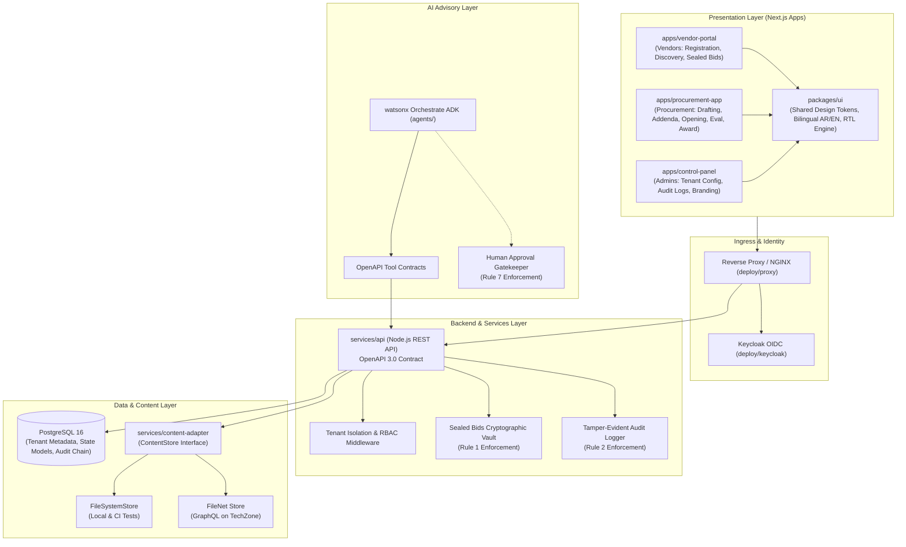

# TenderFlow Architecture Overview

## System Components

### 1. Presentation Layer (`apps/`)
- **Vendor Portal**: Responsive, public-facing portal allowing vendors to register, download public documents, submit questions, and upload cryptographically sealed bid dossiers.
- **Procurement App**: Dedicated workplace for buyers, procurement committees, and directors. Handles tender preparation, issuing addenda, hosting the bid opening ceremony, evaluating scorecards, and issuing awards.
- **Control Panel**: Central operational console for creating and managing multiple tenants, loading tenant configuration packages, and monitoring immutable audit logs.
- **Shared UI (`packages/ui`)**: Unified components supporting dark/light mode, full bidirectional layout (LTR and RTL), with localized English and Arabic strings.

### 2. Core API (`services/api`)
- OpenAPI-first architecture adhering to `services/api/openapi.yaml`.
- Enforces strict tenant isolation per request via JWT / bearer token context.
- Implements the state machine for tenders:
  `DRAFT` -> `PENDING_APPROVAL` -> `APPROVED_FOR_PUBLICATION` -> `PUBLISHED` -> `CLOSED` -> `BIDS_OPENED` -> `EVALUATED` -> `AWARDED` -> `ARCHIVED`.

### 3. Sealed Bid Vault
- Enforces Non-Negotiable Rule 1:
  - Bids uploaded by vendors receive envelope cryptographic verification (SHA-256 + symmetric key encryption).
  - Storage metadata records submission timestamps and hash receipts.
  - Bid files are locked. Any retrieval request before `TENDER.state == BIDS_OPENED` returns HTTP 403.
  - Bid Opening Ceremony requires authorized committee credential sign-off, which emits a certified opening audit event and releases the envelope key.

### 4. Content Adapter (`services/content-adapter`)
- Decouples file storage from core business logic.
- Implements `ContentStore` with two interchangeable drivers:
  - `FileSystemContentStore`: Used for lightning-fast unit tests and offline demonstration.
  - `FileNetGraphQLContentStore`: Integrates with IBM FileNet Content Services GraphQL API for production TechZone reservations.

### 5. Multi-Tenant Configuration Architecture
- Tenants are instantiated via YAML/JSON packages containing:
  - Organization metadata (name, logos, contact info, language preference).
  - Tender category taxonomy (IT, Works, Consulting, Supplies).
  - Approval threshold matrix (e.g. tenders above 100,000 KWD require Director sign-off).
  - Localized terminology overrides.
