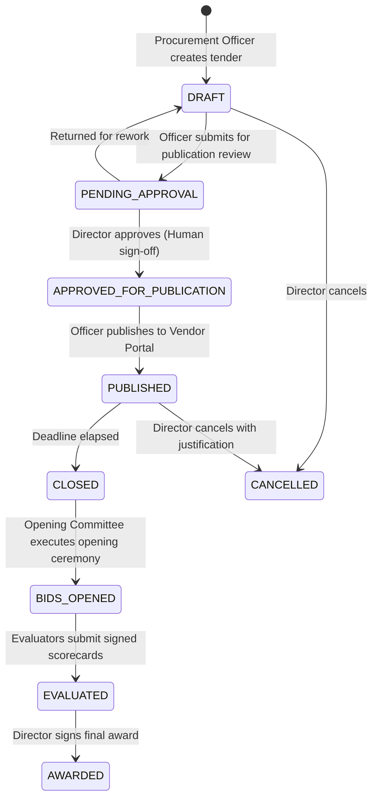
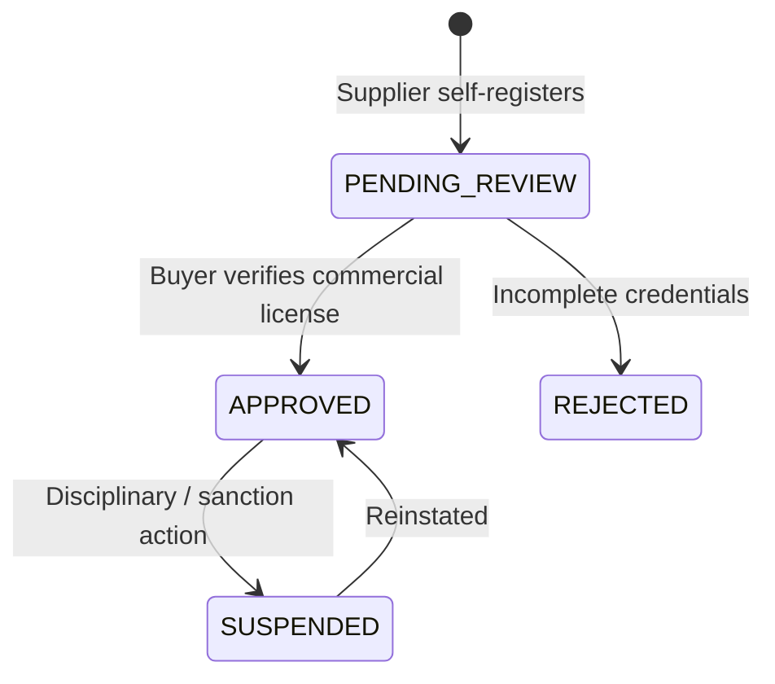
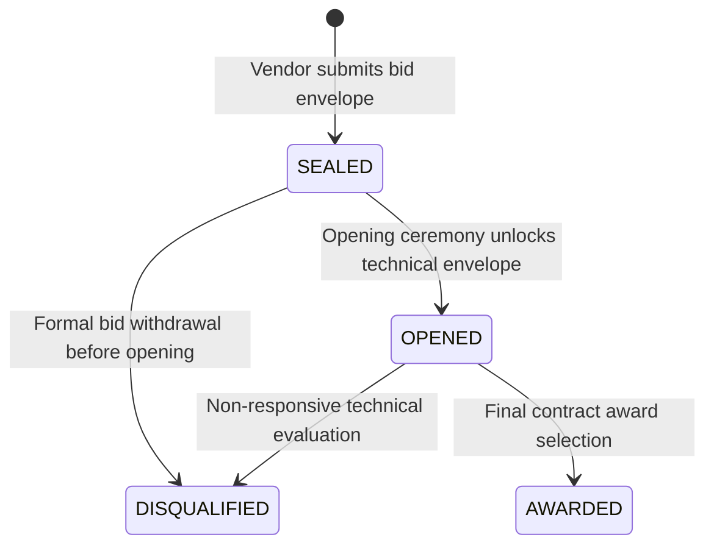

# TenderFlow Domain State Model Specification (Task T02)

**Author**: Agent A1 (Product & Domain Lead)  
**Governing Standard**: Multi-Tenant Regulated Procurement State Machine  
**Rule**: Every state change writes an immutable audit record (Rule 2).

---

## 1. Tender State Lifecycle

### Tender Transitions & Audit Table

| From State | To State | Triggered By | Conditions & Rules | Mandatory Audit Event |
|---|---|---|---|---|
| `*` (New) | `DRAFT` | `PROCUREMENT_OFFICER` | Valid bilingual titles, estimated budget > 0 | `TENDER_CREATED` |
| `DRAFT` | `PENDING_APPROVAL` | `PROCUREMENT_OFFICER` | Specifications attached, AI completeness check reviewed | `TENDER_SUBMITTED_FOR_APPROVAL` |
| `PENDING_APPROVAL` | `APPROVED_FOR_PUBLICATION`| `DIRECTOR` | **Rule 7 Gate**: Formal recorded human sign-off with reason | `TENDER_APPROVED_FOR_PUBLISH` |
| `PENDING_APPROVAL` | `DRAFT` | `DIRECTOR` | Revision requested; change comments recorded | `TENDER_RETURNED_FOR_REWORK` |
| `APPROVED_FOR_PUBLICATION`| `PUBLISHED` | `PROCUREMENT_OFFICER` | Public notice visible on Vendor Portal | `TENDER_PUBLISHED` |
| `PUBLISHED` | `CLOSED` | `SYSTEM` / `OFFICER` | Submission deadline reached; no more bids accepted | `TENDER_CLOSED` |
| `CLOSED` | `BIDS_OPENED` | `OPENING_COMMITTEE_CHAIR` | **Rule 1 Gate**: Opening ceremony convened; attendees logged | `BID_OPENING_RECORDED` |
| `BIDS_OPENED` | `EVALUATED` | `EVALUATOR` / `CHAIR` | All technical & financial scorecards signed | `TENDER_EVALUATED` |
| `EVALUATED` | `AWARDED` | `DIRECTOR` | Winner selected based on scoring matrix | `TENDER_AWARDED` |
| `ANY` | `CANCELLED` | `DIRECTOR` | Mandatory legal cancellation justification | `TENDER_CANCELLED` |

---

## 2. Vendor State Lifecycle

### Vendor Transitions & Audit Table

| From State | To State | Triggered By | Conditions & Rules | Mandatory Audit Event |
|---|---|---|---|---|
| `*` (New) | `PENDING_REVIEW` | `APPLICANT` (Vendor) | Commercial license & contact info provided | `VENDOR_REGISTERED` |
| `PENDING_REVIEW` | `APPROVED` | `PROCUREMENT_OFFICER` | Valid registration, clear tax certificate | `VENDOR_APPROVED` |
| `PENDING_REVIEW` | `REJECTED` | `PROCUREMENT_OFFICER` | Non-compliant or expired license | `VENDOR_REJECTED` |
| `APPROVED` | `SUSPENDED` | `DIRECTOR` | Formal sanction or compliance breach | `VENDOR_SUSPENDED` |
| `SUSPENDED` | `APPROVED` | `DIRECTOR` | Clearance of sanction | `VENDOR_REINSTATED` |

---

## 3. Bid State Lifecycle

### Bid Transitions & Audit Table

| From State | To State | Triggered By | Conditions & Rules | Mandatory Audit Event |
|---|---|---|---|---|
| `*` (New) | `SEALED` | `VENDOR` | Submitted before deadline with SHA-256 digest | `BID_SUBMITTED_SEALED` |
| `SEALED` | `OPENED` | `OPENING_COMMITTEE_CHAIR` | **Rule 1 Enforcement**: Unsealed only upon ceremony event | `BID_UNSEALED` |
| `OPENED` | `DISQUALIFIED` | `EVALUATOR` | Technical score below mandatory qualification threshold | `BID_DISQUALIFIED` |
| `OPENED` | `AWARDED` | `DIRECTOR` | Top ranking compliant composite score | `BID_AWARDED` |

---

## 4. Clarification Lifecycle

| From State | To State | Triggered By | Conditions & Rules | Mandatory Audit Event |
|---|---|---|---|---|
| `*` (New) | `PENDING` | `VENDOR` | Submitted prior to clarification cutoff | `CLARIFICATION_SUBMITTED` |
| `PENDING` | `ANSWERED` | `PROCUREMENT_OFFICER` | Reviewed AI draft response, recorded official answer | `CLARIFICATION_ANSWERED` |
